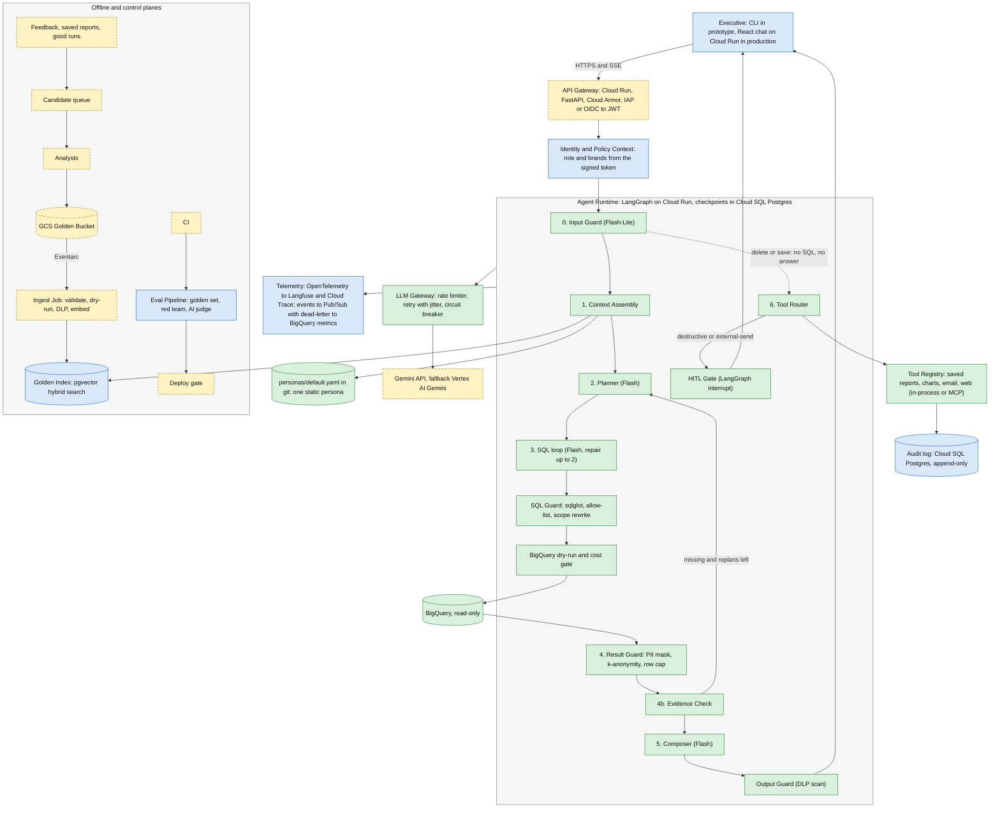
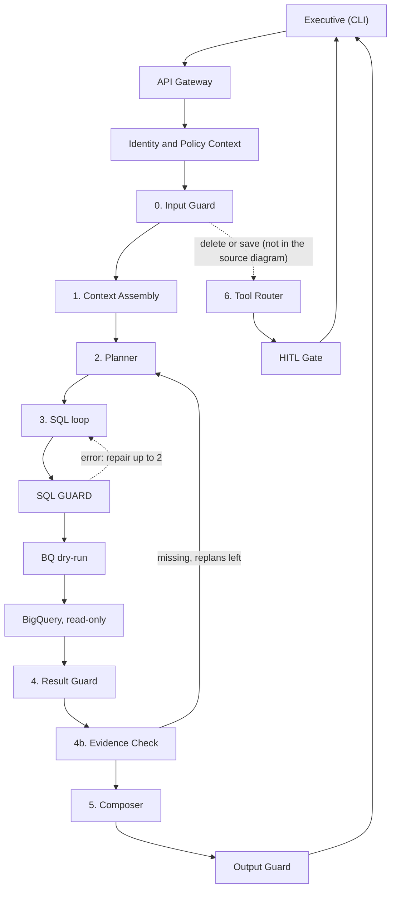
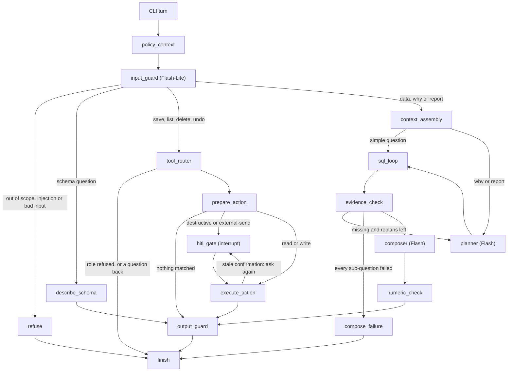
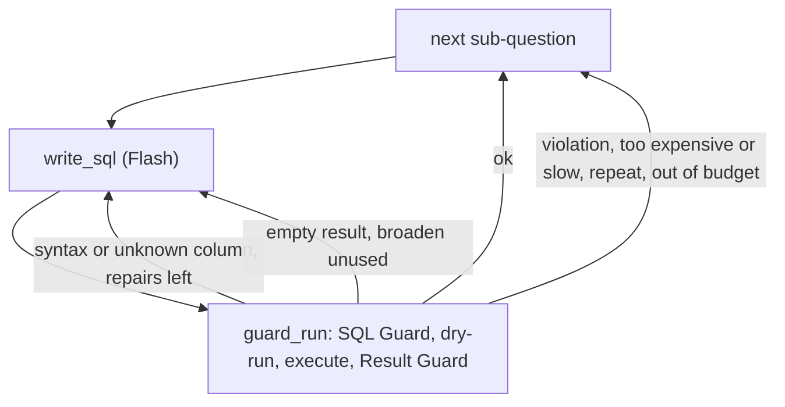

# Architecture (HLD)

Deliverable D1 of the brief: the building blocks, services, compute and flow, with every infrastructure, framework and service choice named and explained. The reasoning behind each choice, the data flow, the error handling and the answer to each of the eight requirements are in [technical-explanation.md](technical-explanation.md). Setup and an example run are in the [README](../README.md).

The diagrams are Mermaid. GitHub draws them on this page. In any other viewer, paste a block into [mermaid.live](https://mermaid.live).

## How to read this document

| Mark | Meaning |
|---|---|
| **Built** | The prototype has it, and tests cover it. |
| **Stand-in** | The prototype has a smaller version of the production block (for example SQLite for Postgres). |
| **Design** | Described here, not built. The prototype does not do it. |
| [DECIDED] [PROPOSED] [OPEN] [NOT SPECIFIED] [CONFLICT] | The status tags of [decision.md](decision.md). A tag on a choice tells you whether a source says it is final. |
| (impl) | Our own implementation choice. No source asks for it. |
| (our proposal) | Our suggestion for production. No source asks for it, and the client has not seen it. |

What the client asked the prototype to cover [DECIDED, client Q&A]: Safety and PII, High-Stakes Oversight (delete saved reports), Resilience, Observability. The other four requirements are design-only (Hybrid Intelligence, system learning, Quality Assurance), or out of scope by the owner's decision of 2026-10-22 (user memory, persona management).

Everything below the prototype line is a design for production. Nothing in this document says a design item works.

## 1. Main diagram (production design)

This is the diagram of the source design ([decision.md](decision.md) section 2), redrawn in Mermaid with the corrections of section 4 below. Green boxes exist in the prototype. Blue boxes have a smaller stand-in. Yellow dashed boxes are design only.

What the stand-ins are:

| Box | Stand-in in the prototype |
|---|---|
| Executive | The Typer and Rich CLI (`chat --user alice`). |
| Identity and Policy Context | `users.yaml` read again on every turn. An empty brand list means no access, and only the CEO has the explicit all-brands flag (S14). |
| Golden Index | `golden/seed/*.yaml` and `glossary.yaml` with an in-memory TF-IDF search. Optional "nice touch" [DECIDED, client Q&A]. |
| Telemetry | A local span file per turn, `runs.jsonl`, `/trace` and `/metrics`. |
| Audit log | An append-only table in SQLite, protected by triggers. |
| Eval Pipeline | The `eval/` commands and the pytest suite. The AI judge is built as an advisory second pass, over a finished run or, on request, over the turns of a chat (`/eval`). Promptfoo, human labels and the deploy gate are design. |
| Gemini API | Built (`google-genai`) and the default model service, but **not yet run on a live key**: the author's free quota ran out. The prototype was run on a local model through the same gateway; `OPSFLEET_ENV=default` (or `app.environment`) switches back to Gemini with no code change (see the README). |

The two loops of the runtime are bounded in code: the SQL repair loop (one attempt and two repairs) and the replan loop (`max_replans`, 0 in the prototype).

## 2. Request path (the simple view)

The same flow as the main diagram, with the guard and error edges only.

## 3. The graph as built (prototype)

The prototype runs the same design as one LangGraph state graph in one process. This diagram is drawn from `src/agent/graph.py`, so it shows what actually runs. Three paths exist that the source diagram does not draw: a refusal, a question about the data structure, and the failure composer.

Any node that fails ends in `compose_failure`, and then `finish` (the error boundary, section 6.2 of the explanation). The edges for that are left out of the picture to keep it readable.

Inside `sql_loop`, for each sub-question:

| Node | Model | What it does | Code |
|---|---|---|---|
| `policy_context` | none | Reads `users.yaml`, fails closed (`NO_ACCESS`, `ACCESS_STORE_DOWN`) | `src/agent/nodes/policy.py` |
| `input_guard` | Flash-Lite | Cleans the text, then one structured call: in scope, injection, intent, selector, standalone question. Then a check in code: a data question must hold a word of the store's domain in what the user typed (`guards/domain_words.py`, plan 12), or the turn ends with a question the code wrote | `nodes/input_guard.py` |
| `refuse` | none | A fixed refusal text | `nodes/failure.py` |
| `describe_schema` | none | Lists the allow-listed tables and columns | `nodes/schema_answer.py` |
| `context_assembly` | none | Dates, locked definitions, persona, glossary, similar trios (the last two only when `golden.enabled` is true: it is false in `config.yaml`, true in the local and BigQuery configs) | `nodes/context.py` |
| `planner` | Flash | At most 4 sub-questions, no SQL | `nodes/planner.py` |
| `sql_loop` | Flash | Write SQL, guard, run, mask, repair | `nodes/sql_loop.py` |
| `evidence_check` | code, plus Flash-Lite | Is the evidence enough? Replan, or answer partially | `nodes/evidence.py` |
| `composer` | Flash | Writes the body of the answer | `nodes/composer.py` |
| `numeric_check` | none | Every number must come from a result | node in `nodes/composer.py`, logic in `src/agent/numeric_check.py` |
| `output_guard` | none | Blocks the whole answer on personal data | `nodes/composer.py` |
| `tool_router`, `prepare_action`, `hitl_gate`, `execute_action` | none | Find, preview, confirm, act | `nodes/tools.py` |
| `compose_failure`, `finish` | none | An honest message with a trace ID; the metrics row | `nodes/failure.py`, `nodes/finish.py` |

## 4. Corrections to the source diagram

The source diagram is `Phase1-decisions.md` section 2, copied into [decision.md](decision.md) section 2. We changed it in these ways.

| # | Correction | Why |
|---|---|---|
| 1 | **Added the delete-or-save shortcut** from the Input Guard to the Tool Router. | A delete or save needs no SQL and no answer. The source text says so, but the diagram has no such edge (Q7, default yes). |
| 2 | **The Evidence Check (4b) is described here, not in "section 3.18".** | The source points to a section 3.18 that does not exist. We built it from the diagram text: a code check, plus a Flash-Lite check on why and report turns. |
| 3 | **Dropped the Memory Store** ("User prefs + My style / memory"). | The memory agent is out of scope (owner decision, 2026-10-22). No design for it is given anywhere. |
| 4 | **The audit log lives in Cloud SQL Postgres, not in BigQuery.** Only metrics go to BigQuery. | The audit log must not share a pipeline with debug traces (Phase1 3.9). It is append-only, with a different role and a longer retention. |
| 5 | **Dropped the Persona Registry, the Persona Admin UI, "CEO office" editing and per-user "My style".** | Persona management is out of scope (owner decision, 2026-10-22). The persona is one static file in git. |
| 6 | **The step inputs are written down** (what each step may see). | Two tables in the requirements folder (`recommended-input.PNG`, `composer-input.PNG`) define them. The diagram shows no data inputs. They are the "prompt contracts" in section 4 of the explanation, and a test checks every built prompt against them. |
| 7 | **The login token is the only source of brands.** The source diagram looks them up in a Cloud SQL table. | The client says the frontend sends a signed token with the user's brands (client Q&A). Q39 is still open: the default is that the token replaces the table. |

Additions we found while building. None of them changes the design; the source diagram did not draw them.

| # | Addition | Why |
|---|---|---|
| 8 | **`describe_schema`**: a path for "what data do you have?" | Brief: "answer questions about the general structure of the database". decision.md section 7.3 said no step covered it. |
| 9 | **`refuse` and `compose_failure`** as nodes. | A refusal is not a failure. A failure always ends in an honest message and a trace ID, never a crash. |
| 10 | **`numeric_check`** between the Composer and the Output Guard. | The source diagram names a numeric grounding check but not where it sits. |
| 11 | **The Result Guard runs in the same node as the query.** | Raw rows never leave the node that ran the query. The source says "before the LLM sees rows". We also keep them out of the graph state and the checkpoints. |
| 12 | **Inline scope views instead of BigQuery authorized views.** | The public dataset is not ours, so we cannot create views or policy tags in it. The SQL Guard rewrites each base table into a filtered subquery. Production can use authorized views over a curated dataset. |

## 5. Service table

One row per building block: what it does, the technology, why, the alternative we rejected, and the prototype stand-in. Sources are decision.md sections 2 and 3. "None recorded" means decision.md names no rejected alternative. (impl) and (our proposal) mark a cell that no source says.

| Block | What it does | Technology | Why | Rejected alternative | Prototype |
|---|---|---|---|---|---|
| Executive client | Chat | CLI in prototype. React chat on Cloud Run in production (our proposal; the client did not name a frontend). | The brief asks for a CLI. | A web frontend in the prototype: out of scope. | Typer and Rich CLI. **Built.** |
| API Gateway | Authenticates the user and passes the signed token on | Cloud Run, FastAPI, Cloud Armor, Identity-Aware Proxy or OIDC to a JWT [PROPOSED] | Authenticates and passes the token on. Managed and scales to zero (our proposal). | One access check at the gateway alone. A gateway cannot mask what BigQuery returns, so it only says who the user is. | `--user NAME`. **Stand-in.** |
| Identity and Policy Context | Role and brands of the user | The signed token from the frontend (client Q&A). Q39 open. | The client said the frontend sends a JWT with the brands. Code enforces access from it. | Open (Q39): the Phase1 design looks the brands up in a Postgres table. Our default is that the token is the only source. | `users.yaml`, read every turn. **Stand-in.** |
| Agent Runtime | Runs the graph, saves a checkpoint after each step | LangGraph (Python) on Cloud Run, checkpoints in Cloud SQL Postgres [PROPOSED, 3.1] | Predictable cost and speed, each step testable alone, and `interrupt()` plus checkpoints make the confirmation pause survive a restart. | Google ADK (less control of state and loops); a hand-written loop (we would rebuild resume, budgets and per-node tests); CrewAI or AutoGen (not predictable, many tokens). Revisit if we move to Vertex AI Agent Engine. | LangGraph in one process, `SqliteSaver`. **Built.** |
| 0. Input Guard | In scope? Attack? What intent? | `gemini-3.5-flash-lite` with a fixed JSON schema [PROPOSED, 3.2] | A cheap model is enough for a three-question classification. It is a cheap first filter, not the security wall. | Pro for everything: too much quota and money. | **Built.** If the guard fails, the request is blocked (S10, Q13). |
| 1. Context Assembly | Gathers dates, definitions, persona, similar trios and glossary once per turn | pgvector hybrid search (vector plus full text), persona file [PROPOSED, 3.3] | One place for every lookup, one fail-open rule, and the turn is resumable. | Vertex AI Vector Search (always-on cost); BigQuery `VECTOR_SEARCH` (seconds of delay); a managed vector service (an extra vendor). Revisit above about 1M items. | In-memory TF-IDF; `golden/seed/*.yaml`. **Stand-in.** |
| 2. Planner | Splits a "why" or report question into at most 4 sub-questions. Writes no SQL. | `gemini-3.8-flash` | Best balance of cost, quality and rate limit. It writes no SQL, so a bad plan can waste calls but cannot expose data: every sub-question still goes through the SQL Guard. | None recorded. | **Built.** |
| 3. SQL loop | Writes SQL for each sub-question and repairs it up to 2 times | `gemini-3.8-flash`. The last repair may use `gemini-3.1-pro-preview` (off in the prototype). | Pro only when Flash has already failed. | One model with no escalation. | **Built.** Pro off. |
| SQL Guard | Checks the parse tree, blocks PII columns, adds the brand filter and the LIMIT | sqlglot (BigQuery dialect), plain Python [PROPOSED, 3.5] | It checks the parse tree, not the text, so comments, spacing and keyword splitting do not matter. The SQL that runs is regenerated from the rewritten tree. | Keyword block lists (easy to get around); asking the model to check itself; the read-only role alone. Revisit if sqlglot fails on many valid queries: then the dry-run parses and sqlglot only rewrites. | **Built.** |
| Dry-run and cost gate | Syntax, schema and bytes check before any spend | BigQuery dry-run, `maximum_bytes_billed`, job timeout, job labels | The dry-run is free and parses the query in BigQuery itself. | None recorded. | **Built.** Run on real BigQuery in the evaluation of 2026-10-25 (about 48 dry runs, none rejected). |
| BigQuery | The data | `bigquery-public-data.thelook_ecommerce`, read-only role. In production, authorized views and policy tags over a curated dataset. | Read-only is required. Views and tags are the production version of the scope rewrite. | Relying on the read-only role alone: it limits writes, not what is read. | Public dataset, or generated sample data in DuckDB. |
| 4. Result Guard | Masks PII, hides small groups, caps rows, replaces customer IDs | Plain Python [DECIDED, 3.4] | Masking before the model keeps PII away from the model and from the Gemini API. | Showing the real `users.id` as "Customer #id": the real key would reach Gemini and the user. | **Built.** |
| 4b. Evidence Check | Do the results answer the question? | Code check, plus Flash-Lite on why and report turns | A code check is free. The model only adds a gap the code cannot see. | None recorded. | **Built.** |
| 5. Composer | Writes the answer body in the persona's tone | `gemini-3.8-flash`, then the numeric grounding check | The persona touches only this step, so a tone change cannot break SQL. | None recorded. | **Built.** |
| Output Guard | Scans the final text for PII, blocks the whole answer on a finding | Pattern scan in the prototype. Cloud Sensitive Data Protection in production; Model Armor optional. | The last of four layers. A finding means an earlier layer failed. | None recorded. (impl: we block the whole answer and do not cut out the match, because we cannot be sure what surrounds it.) | Patterns. **Stand-in.** |
| 6. Tool Router and Tool Registry | Picks a tool by intent, validates arguments, routes by risk class | Tool manifests; in-process or MCP [PROPOSED, 3.14] | A new tool needs no graph change. Email and deletes use the same confirmation step. | Tools coded into the graph; one agent per capability. Revisit above about 10 tools: use an MCP gateway. | Registry and manifests. **Built.** Charts, email, web: **Design.** |
| HITL Gate | Pauses for the user's typed confirmation | LangGraph `interrupt()` with a durable checkpoint [PROPOSED, 3.6] | The pause survives a restart. Only the user's typed reply can confirm. | A pop-up for everything; a model-judged "are you sure"; undo only. | **Built.** |
| Saved Reports store | Reports with an owner, soft delete and undo | Cloud SQL Postgres (our proposal) | A relational store with a unique idempotency key and transactions (our proposal). | None recorded. | SQLite. **Stand-in.** |
| Audit log | Append-only record of save, delete and undo | Cloud SQL Postgres with a role that cannot update or delete [PROPOSED] | Must not share a pipeline with debug traces (Phase1 3.9). | BigQuery through the telemetry pipeline (the source diagram). | SQLite with triggers. **Stand-in.** |
| LLM Gateway | One door for every model call: rate limit, retry with jitter, breaker, fallback, call budget | A small module over the `google-genai` SDK [PROPOSED, 3.2, 3.11] | One place counts every call, so retries cannot hide cost. | (impl) The SDK's own retries: they would hide calls from the budget. | **Built.** Vertex AI fallback: **Design.** |
| Telemetry | Spans, metrics, a short trace ID per turn | OpenTelemetry to Langfuse (self-hosted) and Cloud Trace; Pub/Sub with a dead-letter topic to BigQuery metrics [DECIDED, 3.12] | A trace ID in each error opens the full conversation view. | LangSmith (hosted; PII residency concerns). Revisit if the client already uses Datadog or Grafana. | Local span file, `runs.jsonl`, `/trace`, `/metrics`. **Stand-in.** |
| Golden Bucket and Ingest Job | Analyst-approved trios in Cloud Storage; an Eventarc job validates, dry-runs, scans for PII and embeds them | Cloud Storage, Eventarc, Cloud Sensitive Data Protection, `gemini-embedding-001` [PROPOSED, 3.3] | Source of truth in a versioned bucket; the index is rebuilt from it. | Automatic promotion of candidates: it opens the door to poisoning. | Seed files and `golden validate` (the Ingest Job in miniature). **Stand-in.** |
| Candidate queue | Holds candidate trios until an analyst approves them | [NOT SPECIFIED] where it lives (Q16) | Nothing reaches the index without a human. | None. | None. **Design.** |
| Eval Pipeline | Tests before deploy | evalkit and Promptfoo in CI; golden test set, attack tests, AI judge [PROPOSED, 3.13] | Cheap checks first. One PII leak fails the run. The judge should not grade its own model; when it must (one local model, or Gemini with Pro off), every result is marked "not independent" (`evaluation.allow_self_judge`). | Grading SQL by string match; self-grading that is not marked as such. | `eval/` commands and pytest. **Stand-in.** |
| Async workers | Long reports in the background | Cloud Tasks to a Cloud Run worker; progress rows in Postgres; dead-letter queue [PROPOSED] | A report should not hold a user's connection open. | A state bus beside the graph state: the graph state already carries the data. | Synchronous, with progress lines. **Design.** |
| Persona | Tone and report sections | `personas/default.yaml` in git [DECIDED, 3.9] | Out of scope to manage it (owner decision). | A Persona Registry with an admin UI. | **Built** (one file). |
| Secrets | Gemini key, database credentials | A secret store (our proposal, Q16 default) | Keys never live in config files or git. | None. | `.env`, git-ignored. **Stand-in.** |

## 6. Compute and how the components talk

Compute and wiring for production. The source design names the services but does not name the protocols or the authentication between them, so those columns are (our proposal) unless a tag says otherwise.

| From | To | How | Sync or async | Data that moves |
|---|---|---|---|---|
| Executive | API Gateway (Cloud Run) | HTTPS, and SSE to stream progress [PROPOSED, source diagram] | Sync | The question; progress lines; the final answer (only after the Output Guard) |
| API Gateway | Agent Runtime (Cloud Run) | Internal HTTPS, the signed token passed on | Sync | The question and the token claims (user, role, brands) |
| Agent Runtime | Cloud SQL Postgres | SQL over a private connection | Sync | Checkpoints, saved reports, audit rows, idempotency keys |
| Agent Runtime | Golden Index (pgvector, same Postgres) | SQL | Sync | The standalone question in, up to 3 trios out |
| Agent Runtime | BigQuery | REST through the client library, under a read-only service account; every job has a byte cap, a timeout and labels | Sync | Guarded SQL and parameters in; raw rows back, into the Result Guard only |
| Agent Runtime | LLM Gateway | In-process | Sync | Prompts built from the step contracts; structured replies |
| LLM Gateway | Gemini API, then Vertex AI Gemini | HTTPS, API key in the secret store for the first; IAM for Vertex | Sync | Prompts and replies. Never raw rows, never real customer IDs. |
| Agent Runtime | Telemetry | OpenTelemetry (OTLP) to Langfuse and Cloud Trace; events through Pub/Sub, with a dead-letter topic, into BigQuery | Async | Spans and one metrics row per turn, masked. No rows, no cell values. |
| Tool Router | MCP servers (charts, email, web) | MCP, out of process, with their own credentials | Sync | Validated arguments; results are scanned like any other output |
| Analysts | GCS Golden Bucket | Upload | Async | Approved trios |
| GCS | Ingest Job | Eventarc trigger | Async | A new or changed trio |
| Ingest Job | Golden Index | SQL | Async | Validated, scanned, embedded trios |
| Feedback, saved reports, good runs | Candidate queue | A job that scrubs PII first | Async | Candidate trios |
| CI | Eval Pipeline, then the deploy gate | Pipeline run | Async | Test results; a failed floor blocks the release |

| Compute | Runs | Notes |
|---|---|---|
| Cloud Run service: gateway | FastAPI, authentication, SSE | Scales to zero; Cloud Armor in front [PROPOSED] |
| Cloud Run service: agent runtime | The LangGraph graph | One active run per conversation (3.10). Checkpoints in Postgres, so any instance can resume. |
| Cloud Run worker, fed by Cloud Tasks | Long reports | Writes progress rows to Postgres; the API instance that holds the SSE connection polls them |
| Cloud Run job, fed by Eventarc | The Golden Ingest Job | Also runs a nightly re-check of every approved trio's SQL |
| Self-hosted Langfuse | Trace and session views | In the VPC, because traces are sensitive |
| CI runner | The Eval Pipeline | Per pull request, nightly and pre-release |

In the prototype all of this is one Python process and one SQLite file.

## 7. Prototype versus production

Copied from [decision.md](decision.md) section 8, with the status of each row.

| Production | Prototype stand-in | Status |
|---|---|---|
| Cloud Run, login token with the user's brands | Typer and Rich CLI, `--user alice` from `users.yaml` with her brands | Stand-in |
| LangGraph on Cloud Run | LangGraph in the same process | Built |
| Cloud SQL Postgres (checkpoints, reports, audit) | SQLite (`SqliteSaver` plus app tables) | Stand-in |
| Golden Index, Cloud Storage bucket, ingest job, glossary | `golden/seed/*.yaml`, `glossary.yaml`, in-memory search (optional, "a nice touch") | Stand-in (optional slice) |
| BigQuery authorized views and policy tags | sqlglot guard with scope rewrite and approved column list | Stand-in |
| Cloud Sensitive Data Protection, Model Armor | Pattern-based PII scanner and column masking | Stand-in |
| Vertex AI fallback | Flash to Flash-Lite fallback, plus `--chaos` flag (429s, timeouts, bad SQL) | Built. Vertex AI: design |
| OpenTelemetry to Langfuse and Cloud Trace; Pub/Sub metrics to BigQuery | Local span log, `runs.jsonl`, `/trace` and metrics commands, optional Phoenix | Stand-in (Phoenix is not used) |
| Cloud Tasks background workers | Synchronous, with progress shown | Stand-in |
| Idempotency keys, failed-job queues | Unique `idempotency_key` column and tests. Failed-job queues are design-only. | Keys built. Queues: design |
| Bounded replan | Off by default (`max_replans` = 0) | Built, off |
| Eval pipeline | Pytest for guards, PII scanner, confirmation flow; 16 golden cases; 27 attacks; `--chaos` runs; 11 trajectory cases and nine path and memory rules on every turn | Stand-in. Full pipeline: design |
| Charts, email, web search | Design-only. The tool registry interface is real. | Design |

Beyond the table, two development aids exist that production does not have: generated sample data in DuckDB (`bigquery.backend: local`) and a model served on the developer's machine (`app.environment: local`). They let the whole app run with no Google sign-in. The banner says `LOCAL SAMPLE DATA` and `LOCAL MODEL` wherever a local run could pass for a live one. They do not replace the live steps listed in section 9 of the explanation.

## 8. Data stores and retention

Copied from [decision.md](decision.md) section 6. The cells that say [NOT SPECIFIED] are left as they are: no source decides them.

| Data | Stored in (production -> prototype) | Contains PII? | Written by -> read by | How long we keep it |
|---|---|---|---|---|
| BigQuery source tables | Public dataset -> same | Yes (`users`) | Google -> SQL loop | Not ours |
| Golden Bucket (trios) | Cloud Storage -> our seed trios in `golden/seed/*.yaml` | No (we write them) | Analysts, us -> Ingest Job | [NOT SPECIFIED] |
| Golden Index | Postgres pgvector -> in-memory | No | Ingest Job -> Context Assembly | [NOT SPECIFIED] |
| Glossary | [NOT SPECIFIED] -> `glossary.yaml` | No | Analysts -> Context Assembly | [NOT SPECIFIED] |
| Candidate queue | [NOT SPECIFIED] -> none | PII removed | Feedback -> analyst review | [NOT SPECIFIED] |
| Access rules (roles, brands) | Login token (client) or Postgres (Phase1) -> `users.yaml` | User identity only | Frontend, admins -> Policy Context | [NOT SPECIFIED] |
| Saved Reports | Cloud SQL Postgres -> SQLite | [NOT SPECIFIED] | Tool Router -> user | Soft delete, 30-day undo |
| Conversation state | Postgres checkpoints -> SQLite | Yes (questions, drafts) | Graph -> graph | 90 days |
| Transcripts | [NOT SPECIFIED] | PII removed | [NOT SPECIFIED] | 90 days |
| Persona file | `personas/default.yaml` in git -> same | No | Developers -> Context Assembly | [NOT SPECIFIED] |
| Traces | Langfuse, Cloud Trace -> local log file (`traces/<id>.jsonl`; with `--debug-prompts` also `<id>.exchange.jsonl`, the message exchange of the turn, with no result row) | [NOT SPECIFIED] | Every step -> developers | [NOT SPECIFIED] (prototype: 90 days, the exchange file with its trace) |
| Metrics events | Pub/Sub, BigQuery -> `runs.jsonl` | [NOT SPECIFIED] | Every turn -> dashboards | [NOT SPECIFIED] |
| Audit log | Cloud SQL Postgres, append-only [PROPOSED] -> SQLite | User hash | Tools -> admins | 1 year (prototype: purged at startup after `retention.audit_days`, 365 at least; the database refuses to delete a younger row) |
| Report progress, idempotency keys | Postgres -> SQLite key column | No | Worker, tools -> API, tools | [NOT SPECIFIED] |
| Evaluation data | `eval/datasets/` -> same | No (synthetic) | Analysts -> eval pipeline | [NOT SPECIFIED] |
| Caches | Schema, brands and product categories (`data/cache/*.json`); persona (in-memory, by file mtime); BigQuery's own repeat-query cache (3.15). No app-level query-result or judge cache. Golden retrieval's pgvector cache (3.3) is design-only, out of scope for this prototype's implementation. | No | Steps -> steps | Schema/brands/categories 24h, 7-day outage fallback; persona until the file changes |
| Secrets | [NOT SPECIFIED]; `bq_client.py` uses default credentials | Credentials | [NOT SPECIFIED] | [NOT SPECIFIED] |

Still unanswered by any source (also in [decision.md](decision.md) section 6): where the glossary, the candidate queue, transcripts and secrets live; how long traces and metrics are kept and how PII is removed from them; what a saved report contains and whether it can hold PII.

What the prototype does in practice for the open cells (all (impl) defaults, not decisions): traces are deleted after 90 days (`retention.trace_days`), `runs.jsonl` and `evaluations.jsonl` rows hold counts and IDs only and are deleted after 90 days too (`retention.metrics_days`, at least 31), and a saved report must pass the Output Guard before it is stored.
