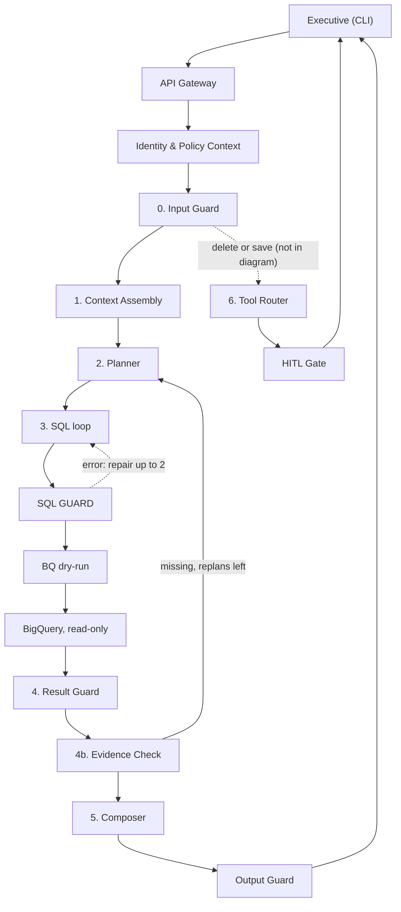

# OpsFleet Data Analysis Agent: Decision Record
Status: draft, refreshed from requirements/ and the client Q&A on 2026-10-22
## Status tags
| Tag | Meaning |
|---|---|
| [DECIDED] | A source says it is final, or the owner approved it |
| [PROPOSED] | A source suggests it, but nobody approved it yet |
| [OPEN] | A source raises it, and there is no answer yet |
| [NOT SPECIFIED] | No source says anything about it |
| [CONFLICT] | Two sources disagree (quote both) |

Where used: every decision heading, every NFR row, and any item that is missing or disputed.
## At a glance
- We build a chat agent for non-technical executives. It answers sales questions on BigQuery data.
- Architecture: a LangGraph graph with fixed steps. Guards check input, SQL, result rows and final text.
- The AI model only suggests. Our code checks every suggestion and enforces the security rules.
- The prototype covers Safety and PII, delete confirmation, resilience and observability. The client confirmed the rest is design-only.
- Each user is a brand manager and sees only their brands. The CEO sees all brands.
- Top risks: small call budget (S3), too big for 6-12 hours (S4), an empty brand list read as "all" (S14).
- Top open questions: which columns are PII (Q11, Q12), the turn budget (Q3), the saved report fields (Q5).
## Contents
[Glossary](#glossary) · [1. Problem framing and scope](#1-problem-framing-and-scope) · [2. Architecture](#2-architecture) · [3. Key decisions](#3-key-decisions) · [4. Non-functional requirements](#4-non-functional-requirements) · [5. Assumptions](#5-assumptions) · [6. Where is the data?](#6-where-is-the-data) · [7. Fit against the original brief](#7-fit-against-the-original-brief) · [8. Prototype vs production](#8-prototype-vs-production) · [9. Sanity check](#9-sanity-check) · [10. Open questions](#10-open-questions) · [11. Next documents](#11-next-documents)
## Glossary
| Term | Meaning |
|---|---|
| AI judge | A stronger, different AI model that scores answers during tests |
| AI model | A large language model (LLM). Here it is Google Gemini. |
| Audit log | A separate, append-only record of actions such as deletes |
| Checkpoint | A saved copy of one conversation's working state after each step |
| CLI | Command-line interface. The prototype chat runs in a terminal. |
| Dry-run | BigQuery checks a query and estimates bytes without running it |
| Golden Bucket | A store of analyst trios. It does not exist, so we seed one. |
| Golden Index | A search index over approved trios, to find similar past questions |
| HITL | Human-in-the-loop: the system pauses until the user confirms an action |
| Idempotency key | A fixed key per action, so a retry never repeats the effect |
| k-anonymity | Hide every group with fewer than k people (default k = 10) |
| Learning loop | How the system improves from use, always after human review |
| MCP | Model Context Protocol. A tool runs as a separate server process. |
| NFR | Non-functional requirement: a quality target such as speed or cost |
| Output Guard | Code that scans the final answer text for PII |
| Persona | The company tone and report style, kept in one static file |
| PII | Personal data that identifies a person, such as name or email |
| PRD | Product requirements document. We write it from this record. |
| Prompt injection | Hidden instructions in text that try to change the model's behaviour |
| Replan | The Planner adds sub-questions when the first results are not enough |
| Result Guard | Code that masks PII and small groups before the model sees rows |
| Saved Reports | The library of reports that users save. Users may delete their own. |
| SQL Guard | Code that checks and rewrites each SQL query before it runs |
| Trace | A record of every step in one turn, with a short trace ID |
| Trio | One example: question, then SQL query, then analyst report |

The step table in section 2 explains each pipeline step. The copied diagram keeps its own short forms, such as BQ and OTel.
## 1. Problem framing and scope
#### Users
| Persona | Needs |
|---|---|
| Brand managers (executives) | Plain answers about their own brands, not SQL. They will not notice a wrong number. |
| CEO | Sees all brands. |
| Analysts | They curate the Golden Bucket. The agent should reuse their logic. |
| Admins (OpsFleet) | They control access, audit, budgets, and debug failures. |
#### What "good" looks like
- Numbers are correct and come from a query. The agent says how it read vague words.
- It explains causes, not only totals.
- PII never appears in an answer. Zero leaks, not "rare" leaks.
- A delete needs one confirmation turn, not three.
- Failures get an honest message. The interface never crashes.
#### What makes it hard
| Hard part | What we do about it |
|---|---|
| User text, retrieved text and database text can steer the AI model | Code enforces every security rule. The model only suggests. |
| PII, per-user brand scope, cost | Guards and byte caps enforce them. Read-only BigQuery alone is not enough. |
| Deletes in Saved Reports | The model gets the intent. A tool finds the IDs. The user confirms them. |
| Learning over time | A human reviews every change to data or prompts |
| Gemini rate limits | Model routing, a rate limiter, fallbacks and fewer calls per turn |
#### Scope
- In scope: a chat agent over `bigquery-public-data.thelook_ecommerce` (tables `orders`, `order_items`, `products`, `users`). It answers questions, discusses them, and writes reports with action items.
- Out of scope: writes to BigQuery. The database is read-only.
- Out of scope (client): data governance, the data ingestion pipeline, data modeling and any outside search service. Another team owns them.
- Prototype [DECIDED]: Safety and PII, High-Stakes Oversight, Resilience, Observability. A Saved Reports store is in, because a delete needs something to delete.
- Design-only [DECIDED]: Hybrid Intelligence, Learning Loop (system learning), Quality Assurance.
- Out of scope [DECIDED] (owner decision, 2026-10-22): a memory agent that learns each user's preferences or builds a profile on its own (3.7); persona management, meaning an editor UI, registry, versions, approval, rollback and per-user style (3.9). The persona is one static file.
- Optional: a small seeded Golden Bucket with search. The client calls it "a nice touch".

Constraints: 6-12 hour time box, Gemini free-tier limits, CLI interface, must run on another machine, dataset `bigquery-public-data.thelook_ecommerce`.
## 2. Architecture
We copied this diagram without changes from Phase1-decisions.md, section 2.

```text
[ Executive ] ── CLI (proto) / React chat on Cloud Run (prod) ── HTTPS + SSE ──┐
                                                                               ▼
[ API Gateway ]  Cloud Run + FastAPI · Cloud Armor · IAP/OIDC → JWT
       ├──> Identity & Policy Context ──SQL──> [ Cloud SQL Postgres: roles, product scopes ]
       ▼
[ Agent Runtime ]  LangGraph on Cloud Run · state checkpoints ──> Postgres
       ├──> 0. Input Guard   Flash-Lite · in-scope? / injection? / intent (JSON-schema output)
       ├──> 1. Context Assembly
       │       ├──> Golden retrieval  pgvector hybrid (vector + FTS) ──> [ Golden Index ]
       │       ├──> Persona + locked policy prompt ──TTL cache──> [ Persona Registry ]
       │       └──> User prefs + My style / memory ──SQL──> [ Memory Store ]
       ├──> 2. Planner       Flash/Pro · splits "why" questions into ≤4 sub-queries · bounded replan (max_replans, config)
       ├──> 3. SQL loop      Flash ─> [ SQL GUARD: sqlglot AST · allow-list · PII lineage · scope rewrite ]
       │       │                    ─> BQ dry-run (cost gate) ─> execute ──REST──> [ BigQuery, read-only ]
       │       └──> error/empty: repair ≤2, error-classified, budgeted ──> back into SQL loop
       ├──> 4. Result Guard  PII mask · k-anonymity · row cap  (BEFORE the LLM sees rows)
       ├──> 4b. Evidence Check  code coverage check (+ Flash-Lite on why/report turns) · enough to answer?
       │       └──> missing + replans left (max_replans, config): missing list + guarded summaries (never rows) ──> back to 2. Planner, new sub-questions run in the SQL loop
       │       └──> missing + none left: Composer writes a partial answer and says what is missing
       ├──> 5. Composer      locked rules + company persona + user style + prefs + numeric grounding check ──> Output Guard (DLP scan)
       └──> 6. Tool Router ──in-proc / MCP──> [ Tool Registry: saved_reports · charts · email · web ]
               └──> risk = destructive | external-send ──> HITL Gate (LangGraph interrupt) ⇄ user

[ LLM Gateway ]  rate limiter · retry+jitter · circuit breaker ──> Gemini API ─fallback─> Vertex AI Gemini
[ Telemetry ]    OTel spans ──OTLP──> Langfuse + Cloud Trace ; events ──Pub/Sub (dead-letter topic)──> BigQuery (metrics + audit)

OFFLINE / CONTROL PLANES
[ Analysts ] ──> [ GCS Golden Bucket ] ──Eventarc──> [ Ingest Job ] validate·dry-run·DLP·embed ──> Golden Index
[ Feedback + saved reports ] ──> candidate queue ──> analyst review ──> GCS        (learning loop)
[ CEO office ] ──> [ Persona Admin UI ] draft → test → approve → activate ──> Persona Registry
[ CI ] ──> [ Eval Pipeline ] golden test set · red-team · LLM judge ──> deploy gate
```
#### Differences from the diagram
- Phase1 says a delete needs no SQL and no answer. The diagram has no shortcut from the Input Guard to the Tool Router.
- The Evidence Check (4b) refers to a section 3.18. That section does not exist in Phase1.
- The diagram has a Memory Store (`User prefs + My style / memory`). We do not build or design it: the memory agent is out of scope (owner decision, 2026-10-22).
- The diagram sends audit events to BigQuery through the telemetry pipeline. We keep the audit log in Cloud SQL Postgres (Phase1 5), because Phase1 3.9 says the audit log must not share a pipeline with debug traces. Only metrics go to BigQuery.
- The diagram has a Persona Registry, a Persona Admin UI, "[ CEO office ]" editing the persona and a per-user "My style". We build and design none of them: persona management is out of scope (owner decision, 2026-10-22). The persona is one static file (3.9).
- The input tables (recommended-input.PNG, composer-input.PNG) define what each step reads. The diagram shows no data inputs.
- The client says the frontend sends a signed login token with the user's brands. The diagram looks up product scopes in Postgres (see Q39).
#### Main request path

#### Steps
| Step | What it does | Tech / model |
|---|---|---|
| Executive | Asks questions in a chat | CLI in prototype. React chat on Cloud Run in production. |
| API Gateway | Checks who the user is | Cloud Run, FastAPI, Cloud Armor, Identity-Aware Proxy |
| Identity & Policy Context | Loads the user's role and brands | Login token (client), Cloud SQL Postgres (Phase1) |
| Agent Runtime | Runs the graph and saves a checkpoint after each step | LangGraph on Cloud Run |
| 0. Input Guard | Decides: in scope, attack, or which intent | `gemini-3.5-flash-lite`, fixed output format |
| 1. Context Assembly | Loads trios, glossary and the persona file once per turn | pgvector search, `personas/default.yaml` |
| 2. Planner | Splits a question into at most 4 sub-questions. Writes no SQL. | `gemini-3.8-flash` |
| 3. SQL loop | Writes SQL for each sub-question. Repairs up to 2 times. | `gemini-3.8-flash` |
| SQL GUARD | Checks the parse tree, blocks PII columns, adds the scope filter | sqlglot, plain Python |
| BQ dry-run, BigQuery | Dry-run checks syntax and bytes. Then the query runs with a byte cap and timeout. | BigQuery, read-only role |
| 4. Result Guard | Masks PII, hides small groups, caps rows | Plain Python |
| 4b. Evidence Check | Asks: do the results answer the question? | Code check, plus Flash-Lite on "why" and report turns |
| 5. Composer | Writes the answer in the persona's tone | `gemini-3.8-flash`, numeric check, Output Guard |
| 6. Tool Router | Runs actions (save, delete, chart, email) by risk class | Tool Registry, in-process or MCP |
| HITL Gate | Pauses for user confirmation on destructive or external actions | LangGraph `interrupt()` |
| LLM Gateway | Limits the call rate, retries, pauses a failing provider, falls back | Gemini API, then Vertex AI Gemini |
| Telemetry | Sends traces, metrics and audit events | OpenTelemetry, Langfuse, Cloud Trace, Pub/Sub, BigQuery |
| Ingest Job | Checks and indexes new trios | Eventarc, dry-run, Cloud Sensitive Data Protection, text vectors |
| Eval Pipeline | Runs tests before deploy | Golden test set, attack tests, AI judge |
## 3. Key decisions
### 3.1 Agent framework [PROPOSED]
- **Choice:** LangGraph (Python). It is a fixed state graph with two limited loops: SQL repair and replan.
- **Why:** Cost and speed are predictable. We can test each step alone. Checkpoints make the confirmation pause survive a restart.
- **Rejected:** Google ADK (less control of state and loops); a hand-written loop; CrewAI or AutoGen (not predictable, many tokens).
- **Revisit if:** we move to Vertex AI Agent Engine, or the team has no LangGraph skill.
- **Source:** (Phase1 3.1). The author's experience level is still a placeholder (see Q8).
### 3.2 AI model choice and routing [PROPOSED]
- **Choice:** Use Gemini models by step (table below). Fallback: primary, sibling model, Vertex AI Gemini, degraded mode.
- **Why:** Cheap models do simple, high-volume steps. Pro runs only after Flash fails.
- **Rejected:** Pro everywhere (too much quota and money); one model with no escalation.
- **Revisit if:** Pro gets a stable release, or free-tier limits block the demo.
- **Source:** (Phase1 3.2, 3.11). The prototype uses Flash, with Pro off. Model IDs need a check at build time.

| Step | Model |
|---|---|
| Input Guard, Evidence Check | `gemini-3.5-flash-lite` |
| Planner, SQL writing, SQL repair, Composer | `gemini-3.8-flash` |
| Last repair, full reports (off in prototype), offline AI judge | `gemini-3.1-pro-preview` (preview only, no stable release) |
| Text vectors for search | `gemini-embedding-001` (Phase1 says "verify") |
### 3.3 Golden Bucket: storage, search and updates [PROPOSED]
- **Choice:** We define the trio format and seed a small set. Cloud Storage holds trios. Postgres with pgvector holds the search index.
- **Why:** At query time the system finds up to 3 similar trios (vector plus full-text search). Below a similarity threshold it adds nothing.
- **Rejected:** Vertex AI Vector Search (always-on cost); BigQuery `VECTOR_SEARCH` (seconds of delay); a vector database service (extra vendor).
- **Revisit if:** more than about 1M items, or search across regions.
- **Data lives in:** Cloud Storage and Postgres. Prototype: `golden/seed/*.yaml` and `glossary.yaml`, in-memory search.
- **Source:** (Phase1 3.3, Client Q&A). Updates: an analyst reviews each candidate. A nightly job re-checks SQL. The trio format is ours to define (see Q43).
### 3.4 Who can see what: access rules and PII [DECIDED]
- **Choice:** Four code layers enforce access (table below). Each user sees only their brands. The CEO sees all brands.
- **Why:** Masking before the model stops it from repeating PII. It also keeps PII away from the Gemini API.
- **Rejected:** One access check at the gateway. The gateway cannot mask what BigQuery returns. Showing the real `users.id` as "Customer #id" (Phase1 6, row 3): the real key would reach Gemini and the user, and could link to the `users` table.
- **Revisit if:** we own the tables and can use BigQuery row-level policies, or users need to follow a customer across sessions.
- **Customer IDs:** The Result Guard maps each `users.id` to a fixed fake ID for the session, for example `Customer #48213`. The same customer gets the same fake ID for the whole session. Real IDs, names, emails and addresses never reach Gemini or the user. (Owner decision, 2026-10-22)
- **Source:** (Phase1 3.4, Result_Guard 2C, Client Q&A). The prompt only informs the model. Nothing relies on it.

| Layer | What it enforces |
|---|---|
| SQL Guard | Allowed tables and columns. Blocks PII columns, also through aliases, `CONCAT` and `SELECT *`. Adds the brand filter. |
| BigQuery (production) | Authorized views, policy tags, byte cap, read-only role |
| Result Guard | Masks PII columns and values. Replaces `users.id` with a fake ID per session. Hides groups below k = 10. Caps rows (example: 50). |
| Output Guard | Pattern scan in prototype. Cloud Sensitive Data Protection in production. |
### 3.5 SQL safety and checks [PROPOSED]
- **Choice:** Order of steps: structured output, sqlglot parse, checks, scope rewrite, dry-run, then run with a byte cap.
- **Why:** The SQL Guard checks the parse tree, not the text. Keyword filters are easy to get around.
- **Rejected:** Keyword or pattern block lists; asking the model to check its own safety; the read-only role alone.
- **Revisit if:** sqlglot fails on many valid queries. Then the dry-run parses, and sqlglot only rewrites.
- **Source:** (Phase1 3.3 SQL loop, 3.5). Checks: one `SELECT` or `WITH`, approved tables only, PII columns, forced `LIMIT`.
### 3.6 Destructive actions and user confirmation [PROPOSED]
- **Choice:** Find, preview, confirm, then delete. The model extracts only the action and a selector. It never sees IDs.
- **Why:** A tool finds reports owned by the user. The confirmation holds a hash of the exact ID set.
- **Rejected:** A pop-up for everything; a model-judged "are you sure"; undo only.
- **Revisit if:** nearly 100% of confirmations are "yes". Then make small deletes lighter.
- **Data lives in:** Saved Reports in Postgres (prototype: SQLite). Soft delete with 30-day undo. Every action goes to the audit log.
- **Source:** (Phase1 3.6). Friction by risk: one report needs y/N. A list needs "yes". "All" needs typing `DELETE 23`.
### 3.7 Learning from each user: out of scope [DECIDED]
- **Choice:** No memory agent. The agent does not learn preferences from past turns and does not build a user profile on its own. There is no per-user style at all (3.9).
- **Why:** Owner decision, 2026-10-22: the memory agent is out of scope. The client Q&A had called it design-only; we now do not design it either.
- **Rejected:** A Background Memory Agent behind a task queue (profile schema, signal scoring, episodic memory, Memory Store); free-text memory (Mem0, LangMem); Vertex AI Memory Bank; a post-turn extractor node inside the graph (Phase1 3.7).
- **Revisit if:** the client asks for the user-level part of the Learning Loop (brief item 4.1) to be designed or built.
- **Data lives in:** Nothing is learned or stored about a user's preferences.
- **Source:** Owner decision, 2026-10-22. `memoryAgent.md` and Phase1 3.7 are no longer used.
### 3.8 Learning for the whole system: feedback, review, failure mining [PROPOSED]
- **Choice:** Thumbs-up, saved reports and good runs become candidate trios. An analyst approves each one.
- **Why:** No change goes live without a human. This blocks poisoned data and drift.
- **Rejected:** Automatic promotion of candidates.
- **Revisit if:** analysts cannot keep up (they review a few dozen a week).
- **Data lives in:** A candidate queue [NOT SPECIFIED], then Cloud Storage.
- **Source:** (Phase1 3.3, 4; README-evaluation 12). Weekly failure mining proposes glossary entries and test cases.
### 3.9 Persona: one static file [DECIDED]
- **Choice:** Two prompt layers: locked rules (git) and one static company persona, a plain file (`personas/default.yaml`: tone, sections, word limit). No persona editor, registry, versions, approval, rollback or per-user style.
- **Why:** Owner decision, 2026-10-22: persona management is out of scope. The persona touches only the Composer. It never reaches SQL writing, so it cannot break queries.
- **Rejected:** A Persona Registry with an admin UI, drafts, tests, second-editor approval and rollback (Phase1 3.8); a per-user "My style"; prompts in environment variables.
- **Revisit if:** the client wants non-developers to change the tone on their own (brief item 8).
- **Data lives in:** `personas/default.yaml` in git. Changing the tone is a normal code change. The prototype re-reads the file when it changes, so a hand edit shows in the next answer.
- **Source:** Owner decision, 2026-10-22. Phase1 3.8 and Phase1 6, row 11 are no longer used.
### 3.10 Agent loop: limits, saved state, duplicate protection [PROPOSED]
- **Choice:** At most 4 sub-questions per turn. Each gets 1 attempt plus 2 repairs. `max_replans` defaults to 1 (prototype: 0). One active run per conversation.
- **Why:** Code stops each loop: tries, Budget, timeout, same SQL twice, same error twice. Budget per simple turn: about 8 calls, about 60 s.
- **Rejected:** Saga-style rollback (each action is one step); rollback of read-only sub-queries.
- **Revisit if:** replans rarely add anything (set `max_replans` to 0), or "why" answers keep missing causes (raise it).
- **Data lives in:** LangGraph checkpoints in Postgres (prototype: SQLite). Raw rows never enter the state.
- **Source:** (Phase1 3.11, 3.13, 3.15-3.17). The idempotency key includes the turn ID, as the Phase1 Q&A says. Without it, saving the same report twice in one conversation would return the first save.
### 3.11 Resilience and cost control [PROPOSED]
- **Choice:** Each error type gets its own handling (table below). Errors go back into state as typed errors.
- **Why:** The interface never crashes. Each error shows a friendly message and a trace ID.
- **Rejected:** One generic retry for every error.
- **Note:** The loop-engineering PNG flagged a missing failed-job queue and a missing "same error twice" stop. Phase1 3.11 now has both.
- **Revisit if:** fallback rates or cost per question grow. Cost levers: Flash-Lite, caches, daily budgets, kill switch.
- **Source:** (Phase1 3.11). On failure, access rules block. Persona and telemetry continue with defaults.

| What happened | What the system does |
|---|---|
| Syntax error or unknown column | Repair with the exact column list |
| Empty result | One check-and-broaden query, then an honest "no data" |
| Guard violation | No retry. Explain the refusal. |
| Query too expensive or too slow | Ask the user to narrow the question |
| Same SQL or same error twice | Stop the loop |
| Gemini error 429 (too many requests) or 5xx | Wait longer before each retry. Pause a failing provider. Use the fallback chain. |
| Report job keeps failing | Failed-job queue, honest message with trace ID |
### 3.12 Observability, monitoring and logging [DECIDED]
- **Choice:** OpenTelemetry spans per step, model call, tool call and query. Langfuse (self-hosted) and Cloud Trace store them.
- **Why:** A short trace ID in each error opens the full conversation view. Each trace records model, prompt and persona versions.
- **Rejected:** LangSmith (hosted service, PII location concerns).
- **Revisit if:** the client already uses Datadog or Grafana for model monitoring.
- **Data lives in:** Langfuse, Cloud Trace, BigQuery (metrics). Audit log in Cloud SQL Postgres, separate from traces. Prototype: local log file, `/trace` command.
- **Source:** (Phase1 3.9). Metrics: task success, guard blocks, PII at output, cost per question. Owner decision, 2026-10-22: Langfuse. The owner considered LangSmith (the "langsmit" note) and rejected it.
### 3.13 Quality checks and evaluation [PROPOSED]
- **Choice:** Three test layers: free code checks, checks against analyst answers, then an AI judge.
- **Why:** Cheap checks run first. One PII leak fails the whole run. The judge never grades its own model.
- **Rejected:** Grading SQL by string match; self-grading.
- **Revisit if:** the judge disagrees with human labels.
- **Data lives in:** `eval/datasets/` (golden test set of 100-200 cases, attack tests, about 50 human labels).
- **Source:** (Phase1 3.10, README-evaluation). Tools: evalkit and Promptfoo. User tests: 5-8 executives.
### 3.14 Extensibility (tool registry) [PROPOSED]
- **Choice:** Each tool has a manifest: schema, risk class, roles, timeout, cost, and whether it can repeat or undo.
- **Why:** A new tool needs no graph change. Email and deletes use the same confirmation step.
- **Rejected:** Tools coded into the graph; one agent per capability.
- **Note:** The loop-engineering PNG flagged missing "idempotent, reversible and inverse" fields. Phase1 3.12 now includes them.
- **Revisit if:** there are more than about 10 tools. Then use an MCP gateway.
- **Source:** (Phase1 3.12). Charts run with no network. Email checks recipient domains. Web results count as untrusted.
## 4. Non-functional requirements
| ID | Requirement | Target | Status tag | Source |
|---|---|---|---|---|
| NFR1 | Response time, simple question | 95% under 30 s (target). About 20 s is the typical case, not a second target. | [PROPOSED] | Phase1 6, row 9; Phase1 1 |
| NFR2 | Response time, multi-step question | 20-60 s with progress. Reports run in the background in production. | [PROPOSED] | Phase1 3.11, 7 |
| NFR3 | Time limit per turn | About 60 s | [PROPOSED] | Phase1 3.11 |
| NFR4 | AI calls per turn | About 8 for a simple turn. "Why" and report turns: [NOT SPECIFIED]. | [OPEN] | Phase1 3.11 |
| NFR5 | SQL attempts per sub-question | 1 attempt plus 2 repairs | [PROPOSED] | Phase1 3.11 |
| NFR6 | Bytes billed per query | Hard cap, value [NOT SPECIFIED] | [OPEN] | Phase1 3.5 |
| NFR7 | BigQuery monthly use | Inside the free tier of 1 terabyte | [DECIDED] | Brief |
| NFR8 | Daily budget per user | Alert at 80%, amount [NOT SPECIFIED] | [OPEN] | Phase1 3.11 |
| NFR9 | Gemini rate limits | Read from config. Not published. | [PROPOSED] | Phase1 intro |
| NFR10 | Scale and availability | About 50 executives, 99.5% | [PROPOSED] | Phase1 6, row 9 |
| NFR11 | PII in final output | Zero | [DECIDED] | Brief R2 |
| NFR12 | Attack test pass rate | 100% | [PROPOSED] | Phase1 3.10 |
| NFR13 | Smallest group shown | k = 10 | [PROPOSED] | Phase1 3.4 |
| NFR14 | Rows sent to the model | 50 (given as an example) | [PROPOSED] | Result_Guard D |
| NFR15 | Access rules store down | Block the request | [PROPOSED] | Phase1 3.4 |
| NFR16 | The model is never the only checker | Code checks every model output | [PROPOSED] | loop-engineering PNG |
| NFR17 | Delete confirmation | One confirmation turn, 30-day undo | [PROPOSED] | Phase1 1, 3.6 |
| NFR18 | No duplicate effects on retry | Zero duplicate saves or emails | [PROPOSED] | Phase1 3.17 |
| NFR19 | Interface never crashes | Friendly message and trace ID | [DECIDED] | Brief R5 |
| NFR20 | Alerts | Alert on any PII at output | [PROPOSED] | Phase1 3.9 |
| NFR21 | How long we keep data | Audit log 1 year. Transcripts and checkpoints 90 days, without PII. | [PROPOSED] | Phase1 6, row 12, 3.15 |
| NFR22 | Traces and logs kept | [NOT SPECIFIED] | [NOT SPECIFIED] | None |
| NFR23 | Persona change | Out of scope (owner decision, 2026-10-22). One static persona file; a tone change is a code change. | [DECIDED] | Brief R8 |
| NFR24 | New tool | No graph change | [PROPOSED] | Phase1 3.12 |
| NFR25 | Release safety | 5% of traffic first, automatic rollback | [PROPOSED] | Phase1 3.10 |
| NFR26 | Answer quality | Not below baseline minus a tolerance [NOT SPECIFIED] | [OPEN] | README-evaluation 6 |
| NFR27 | Usability score | [NOT SPECIFIED] (System Usability Scale) | [OPEN] | README-evaluation 10 |
| NFR28 | Runs on another machine | Setup instructions, Docker optional | [DECIDED] | Brief |
| NFR29 | Who sees which data | Only the user's brands. The CEO sees all brands. | [DECIDED] | Brief R2, Client Q&A |
## 5. Assumptions
| ID | Assumption | Source | What happens if it is wrong | Linked question |
|---|---|---|---|---|
| A1 | Confirmed: scope is the user's brands. Assumed: the filter applies per item in mixed orders. | Client Q&A; Phase1 6, row 1a | Order metrics change | Q41 |
| A2 | The SQL Guard blocks direct identifiers. Other attributes appear only in groups of 10 or more. | Phase1 6, row 2 | PII leaks, or the guards block useful answers | Q11 |
| A3 | A fake ID per session (for example `Customer #48213`) is not PII. Real `users.id` never leaves the Result Guard. Owner decision. | Result_Guard 2C | The agent cannot answer "top customers" | Q12 |
| A4 | The frontend sends a signed token with the user's brands. Roles beyond manager and CEO are Phase1 defaults. | Client Q&A; Phase1 6, row 4 | Identity design changes | Q42 |
| A5 | Churn is no order in 90 days. "Last month" is the calendar month. | Phase1 6, rows 5 and 6 | Answers mislead, or time windows are empty | Q6 |
| A6 | Users may delete only their own reports. No legal hold. | Phase1 6, row 7 | Delete flow needs more rules | Q5 |
| A7 | Production uses Vertex AI in the US | Phase1 6, row 8 | Data rules and costs change | Q18 |
| A8 | About 50 users and 99.5% availability | Phase1 6, row 9 | Sizing changes | Q30 |
| A9 | Production trios: one per line, up to about 10k, in English. Analysts review a few dozen weekly. | Phase1 6, row 10 | Index changes, or the learning loop stalls | Q9, Q19 |
| A10 | Withdrawn (owner decision, 2026-10-22): there is no persona editing or approval flow. | Phase1 6, row 11 | None | Q26 |
| A11 | Transcripts 90 days, audit log 1 year | Phase1 6, row 12 | Storage and privacy rules change | Q17 |
| A12 | Withdrawn (owner decision, 2026-10-22): there is no per-user "My style". | Phase1 6, row 13 | None | None |
| A13 | The dataset is synthetic, so free-tier Gemini terms are fine | Phase1 3.2 | Real data would need Vertex AI | Q18 |
| A14 | The listed Gemini model IDs exist at build time | Phase1 intro | Routing config breaks | Q10 |
| A15 | Confirmed: the Golden Bucket does not exist. We seed a small set of our own trios. | Client Q&A | None, the client confirmed it | Q9 |
| A16 | Questions and answers are in English only | Not stated | Guards and glossary miss other languages | Q34 |
| A17 | Currency is USD and time zone is UTC | Not stated | Wrong numbers or periods | Q6 |
| A18 | The reviewer has a Google Cloud project and a Gemini key | Not stated | Prototype does not run | Q14 |
| A19 | One user at a time on one machine in the prototype | Not stated | SQLite locking issues | None |
| A20 | Saved reports hold no PII and record their conversation ID | Not stated | PII in storage, or "this conversation" delete fails | Q5 |
| A21 | The dataset has no free-text cells with PII | Not stated | Value scanning becomes critical | Q11 |
| A22 | Another team owns data governance, ingestion and data modeling | Client Q&A | We must design the ingestion side | Q40 |
| A23 | Every order item joins to `products.brand`, so the brand filter covers all data | Not stated | Some rows escape the brand filter | Q4 |
| A24 | Brand lists are small and change rarely, so a config file is enough | Not stated | The prototype mapping goes stale | Q39 |
## 6. Where is the data?
| Data | Stored in (production -> prototype) | Contains PII? | Written by -> read by | How long we keep it |
|---|---|---|---|---|
| BigQuery source tables | Public dataset -> same | Yes (`users`) | Google -> SQL loop | Not ours |
| Golden Bucket (trios) | Cloud Storage -> our seed trios in `golden/seed/*.yaml` | No (we write them) | Analysts, us -> Ingest Job | [NOT SPECIFIED] |
| Golden Index | Postgres pgvector -> in-memory | No | Ingest Job -> Context Assembly | [NOT SPECIFIED] |
| Glossary | [NOT SPECIFIED] -> `glossary.yaml` | No | Analysts -> Context Assembly | [NOT SPECIFIED] |
| Candidate queue | [NOT SPECIFIED] -> none | PII removed | Feedback -> analyst review | [NOT SPECIFIED] |
| Access rules (roles, brands) | Login token (client) or Postgres (Phase1) -> `users.yaml` | User identity only | Frontend, admins -> Policy Context | [NOT SPECIFIED] |
| Saved Reports | Cloud SQL Postgres -> SQLite | [NOT SPECIFIED] | Tool Router -> user | Soft delete, 30-day undo |
| Conversation state | Postgres checkpoints -> SQLite | Yes (questions, drafts) | Graph -> graph | 90 days |
| Transcripts | [NOT SPECIFIED] | PII removed | [NOT SPECIFIED] | 90 days |
| Persona file | `personas/default.yaml` in git -> same | No | Developers -> Context Assembly | [NOT SPECIFIED] |
| Traces | Langfuse, Cloud Trace -> local log file | [NOT SPECIFIED] | Every step -> developers | [NOT SPECIFIED] |
| Metrics events | Pub/Sub, BigQuery -> `runs.jsonl` | [NOT SPECIFIED] | Every turn -> dashboards | [NOT SPECIFIED] |
| Audit log | Cloud SQL Postgres, append-only [PROPOSED] -> SQLite | User hash | Tools -> admins | 1 year |
| Report progress, idempotency keys | Postgres -> SQLite key column | No | Worker, tools -> API, tools | [NOT SPECIFIED] |
| Evaluation data | `eval/datasets/` -> same | No (synthetic) | Analysts -> eval pipeline | [NOT SPECIFIED] |
| Caches | Query results by SQL and scope; persona; judge | [NOT SPECIFIED] | Steps -> steps | Short-lived (persona) |
| Secrets | [NOT SPECIFIED]; `bq_client.py` uses default credentials | Credentials | [NOT SPECIFIED] | [NOT SPECIFIED] |

- Nobody says where the glossary, candidate queue, transcripts and secrets live.
- Nobody says how long we keep traces, metrics and caches, or how we remove PII from them.
- Nobody says what a saved report contains, or if it can hold PII.
## 7. Fit against the original brief
### 7.1 Requirements
| # | Brief requirement | Prototype or design-only | Covered in section | Fit |
|---|---|---|---|---|
| 1 | Use Golden Bucket trios with BigQuery | Design-only | 3.3 | Full |
| 2 | No PII, analysis only, own brands | Prototype | 3.4, 3.5 | Full |
| 3 | Confirm before deleting saved reports | Prototype | 3.6 | Full |
| 4.1 | Remember each user's preferences | Out of scope (owner decision, 2026-10-22) | 3.7 | Not covered, by choice. |
| 4.2 | System learns from past interactions | Design-only | 3.8 | Full |
| 5 | Self-correct errors, survive outages, control cost | Prototype | 3.10, 3.11 | Full |
| 6 | Evaluate quality, intent and user experience | Design-only | 3.13 | Full |
| 7 | Metrics and debugging of failures | Prototype | 3.12 | Full |
| 8 | Non-developers change tone without redeploy | Out of scope (owner decision, 2026-10-22) | 3.9 | Not covered, by choice. One static persona file; a tone change is a code change. |
### 7.2 Deliverables
- Architecture diagram: partial. It is text art, not Mermaid. The delete shortcut is missing.
- Technical explanation: 2.1, 2.2, 2.3 and 2.5 exist. 2.4 (setup instructions and example run) is missing.
- Working prototype and public GitHub repository: missing. Only `bq_client.py` exists.
- CLI and "runs on another machine": missing. The design names Typer and Rich for the CLI.
- Framework choice plus experience statement: partial. The experience level is a placeholder.
### 7.3 Agent capabilities and dataset
- Customer behaviour (top customers, total spend): covered, with a fake ID per session.
- Product performance and comparison: covered by the Planner.
- Time-based metrics: covered. "Last month" needs a definition (see Q6).
- Questions about the data structure: not covered. No step describes this path. `bq_client.py` has `get_table_schema`.
- Multi-step questions: covered by the Planner and replan.
- Report with action items: covered by the Composer.
### 7.4 Beyond or against the brief
- Beyond: evalkit, Promptfoo, background workers, Model Armor, idempotency keys, failed-job queues.
- Against: the main diagram is not Mermaid.
- Possibly beyond: the Golden Ingest Job and the policy store. The client says another team owns ingestion (see Q39, Q40).
## 8. Prototype vs production
| Production | Prototype stand-in |
|---|---|
| Cloud Run, login token with the user's brands | Typer and Rich CLI, `--user alice` from `users.yaml` with her brands |
| LangGraph on Cloud Run | LangGraph in the same process |
| Cloud SQL Postgres (checkpoints, reports, audit) | SQLite (`SqliteSaver` plus app tables) |
| Golden Index, Cloud Storage bucket, ingest job, glossary | `golden/seed/*.yaml`, `glossary.yaml`, in-memory search (optional, "a nice touch") |
| BigQuery authorized views and policy tags | sqlglot guard with scope rewrite and approved column list |
| Cloud Sensitive Data Protection, Model Armor | Pattern-based PII scanner and column masking |
| Vertex AI fallback | Flash to Flash-Lite fallback, plus `--chaos` flag (429s, timeouts, bad SQL) |
| OpenTelemetry to Langfuse and Cloud Trace; Pub/Sub metrics to BigQuery | Local span log, `runs.jsonl`, `/trace` and metrics commands, optional Phoenix |
| Cloud Tasks background workers | Synchronous, with progress shown |
| Idempotency keys, failed-job queues | Unique `idempotency_key` column and one pytest. Failed-job queues are design-only. |
| Bounded replan | Off by default (`max_replans` = 0) |
| Eval pipeline | Pytest for guards, PII scanner, confirmation flow; about 15 golden cases; `--chaos` runs |
| Charts, email, web search | Design-only. The tool registry interface is real. |
## 9. Sanity check
### 9.1 Risks the documents already list
| Risk | How we reduce it | What remains |
|---|---|---|
| Cost: multi-step reports multiply calls | Routing, Budget, byte cap, caches | Pro escalation on hard reports |
| Free-tier rate limits | Rate limiter, fewer calls, fallback chain | The demo may hit limits |
| Prompt injection | Untrusted tags, fixed output formats, user-only confirmation | Not zero. So code enforces the rules. |
| SQL data theft | Parse-tree guard, scope rewrite, dry-run, byte cap | Parser gaps. Attack tests cover them. |
| Invented numbers | Numbers only from results, numeric check | A wrong but valid query gives a believable number |
| Re-identification from groups | k-anonymity, row cap | Small segments stay a risk |
| Duplicate effects on retry | Idempotency keys, check before resend | Some providers cannot remove duplicates |
| Runaway loops | Caps, Budget, timeout, repeat checks | A bad plan can still spend its Budget |
| Confirmation fatigue | Friction by risk, soft delete and undo | Needs real usage data to tune |
| Cold start: no trios on day 1 | Glossary, answers without examples, seed trios | Early answers are weaker |
### 9.2 New findings
This section is our own opinion, not a fact from the sources.

| ID | Severity | Finding | Suggested fix |
|---|---|---|---|
| S1 | High | `products.brand` is free text. A typo in the brand mapping gives an empty scope without warning. | At startup, check mapped brands against the real brand list |
| S2 | High | `bq_client.py` has no dry-run, byte cap, timeout, labels or row cap. | Wrap it before any query runs |
| S3 | High | About 8 calls per turn cannot cover up to 12 SQL calls plus other steps. | Set a separate number for "why" and report turns |
| S4 | High | The full design does not fit 6-12 hours. | Build only guards, delete flow, retries, local traces |
| S5 | High | Search filters trios by table, not by brand. A report excerpt can show other brands' numbers. | Tag each trio with its brands and filter on them |
| S6 | High | `bq_client.py` logs the full error text. Errors and traces can hold data values. | Mask logs. Set a PII rule for traces. |
| S7 | High | "Top customers" returns groups of one. k = 10 would hide them all. | Define a rule for per-customer rows with fake IDs per session (for example: allowed only for ranked spend lists, never with demographic columns) |
| S8 | Medium | Saved reports have no conversation ID. "Delete reports from this conversation" cannot work. | Add owner and conversation ID to the report schema |
| S9 | Medium | Streaming text before the Output Guard runs could show PII. | Stream only progress until the scan passes |
| S10 | Medium | Nobody says what happens if the Input Guard fails. | Block the request |
| S11 | Medium | Nobody says what happens when the numeric check fails. | Remove the number and say so, or retry once |
| S12 | Medium | Parallel sub-queries plus retries can cause a burst of 429 errors. | Tie the parallel limit to the rate limiter |
| S13 | Low | The AI judge uses a preview Pro model. Its scores can shift. | Pin the ID and recalibrate on change |
| S14 | High | If code reads an empty brand list as "all brands", a missing mapping shows everything. | Give the CEO an explicit "all brands" flag. Empty means no access. |
| S15 | Medium | A customer buys from many brands. A manager sees only part of that customer's spend. | Label customer totals as "spend on your brands" |
### 9.3 Verdict
- The design answers all eight requirements in depth. It is a good base for the architecture document.
- The brand scope is now defined. The PRD still needs the PII column list (Q11) and the customer-row rule (S7).
- The internal conflicts were resolved on 2026-10-22. The Budget numbers (S3) are still open.
- Cut the prototype to the four required areas. Answer the P0 questions before writing either document.
## 10. Open questions
| ID | Question | Default if unanswered | Who answers | Priority |
|---|---|---|---|---|
| Q1 | **Access:** What does "products related to him" mean without an owner column? Does scope apply per item? | Answer: each user manages one or more brands. The CEO sees all. Per item: see Q41. | OpsFleet client | Answered |
| Q2 | **Access:** How do users log in, in the CLI and in production? | Answer: production frontend sends a signed token with brands. Prototype: a config mapping. | OpsFleet client | Answered |
| Q3 | **Budget:** How many calls, tokens, seconds and bytes may one turn and one query use? | Simple turn about 8 calls and 60 s. Low byte cap in config. | Us | P0 |
| Q4 | **Data:** What are the real columns and the latest date in the dataset? | Check with `bq show --schema` | Us | P0 |
| Q5 | **Data:** Saved Reports: fields, storage, soft or hard delete, undo time, legal hold? | Owner, conversation ID, text. Soft delete, 30-day undo. | OpsFleet client | P0 |
| Q6 | **Definitions:** What do churn, underspending, "last month", currency and time zone mean? | Churn 90 days, calendar month, USD, UTC | OpsFleet client | P0 |
| Q7 | **Diagram:** Do we add the Input Guard to Tool Router shortcut? | Yes | Us | P0 |
| Q8 | **Framework:** Is LangGraph fine? What is the author's experience level? | LangGraph, honest statement from the author | Us | P0 |
| Q9 | **Golden Bucket:** Does it exist? What format? Do we fake it and search it in the prototype? | Answer: it does not exist. We define the format and seed a small set. Search is optional. | OpsFleet client | Answered |
| Q10 | **Models:** Which Gemini models? Is Pro in the routing table? | Flash only, Pro escalation off, Pro for the judge | OpsFleet client | P0 |
| Q11 | **PII:** Which columns are PII? Which does the SQL Guard block, and which does the Result Guard mask? | Block direct identifiers. Others only in groups of 10 or more. | OpsFleet client | P0 |
| Q12 | **PII:** Do we show "Customer #id" or a new fake ID per session? May per-customer rows reach the model? | Answer: a fixed fake ID per session (`Customer #48213`). Real IDs never reach the model. Per-customer rows are allowed for top-customer questions (see S7). | Us | Answered |
| Q13 | **Safety:** What happens when the Input Guard fails? | Block the request | Us | P0 |
| Q14 | **Setup:** What does the reviewer need to run the prototype? | Google Cloud project, Gemini key, `pip install` | Us | P0 |
| Q15 | **Budget:** What is the daily budget per user? | Alert at 80%, amount from client | OpsFleet client | P1 |
| Q16 | **Data:** Where do the glossary, candidate queue and secrets live? (Audit log: Cloud SQL Postgres, proposed) | Postgres for the glossary index. A secret store for keys. | Us | P1 |
| Q17 | **Data:** Where does history live? How does a user delete it? | Checkpoints 90 days. | OpsFleet client | P1 |
| Q18 | **Deployment:** What is the production target and region? | Cloud Run, Cloud SQL, Vertex AI, US | OpsFleet client | P1 |
| Q19 | **Evaluation:** Who builds and labels the golden test set and reference SQL? | Analysts, a few dozen items a week | OpsFleet client | P1 |
| Q20 | **Evaluation:** What are the pass and fail numbers for each gate? | Set from the first baseline run | Us | P1 |
| Q21 | **Golden Bucket:** Do we filter trios by the user's brands? How do updates stay safe? | Yes. Analyst review, nightly re-check, no automatic promotion. | Us | P1 |
| Q22 | **Loop:** What is the hard ceiling for `max_replans`? Does the cap of 4 cover reports? | Ceiling 2. Cap of 4 covers reports. | Us | P1 |
| Q23 | **Loop:** Do we add the turn ID to the idempotency key? | Answer: yes | Us | Answered |
| Q24 | **Memory:** Do we build a memory agent? | Answer: no. Out of scope (owner decision, 2026-10-22). | Us | Answered |
| Q25 | **Observability:** Which metrics and alert limits? How long are logs kept? (Tool answered: Langfuse) | Alert on any PII, 90 days, mask PII before writing | OpsFleet client | P1 |
| Q26 | **Persona:** How do versions, rollback and editing work? | Answer: they do not exist. One static persona file (owner decision, 2026-10-22). | Us | Answered |
| Q27 | **PII:** What is the row cap for the model? | 50 rows | Us | P1 |
| Q28 | **Resilience:** What are the retry limits and the 429 rules for the free tier? | Limits in config, longer waits per retry, Flash to Flash-Lite | Us | P1 |
| Q29 | **Safety:** Can text stream before the Output Guard? What if the numeric check fails? | Stream progress only. Remove the number and say so. | Us | P1 |
| Q30 | **Scale:** How many users, what availability, and which response time (20 s or 30 s)? | 50 users, 99.5%, 95% under 30 s | OpsFleet client | P1 |
| Q31 | **Escalation:** Is there a path to a human analyst for failed turns? | No, honest message only | OpsFleet client | P2 |
| Q32 | **Evaluation:** How do we measure user experience? Which evalkit layer runs each rubric? | 5-8 executive sessions. Layers set from the rubric file. | OpsFleet client | P2 |
| Q33 | **Extensions:** How do web, email and charts stay safe? Who owns the email domain list? | Same confirmation step and PII scan | OpsFleet client | P2 |
| Q34 | **Language:** Do we support only English? | Yes | OpsFleet client | P2 |
| Q35 | **Loop:** Do we flag failed questions to analysts and label low-confidence answers? | Label yes, flag later | Us | P2 |
| Q36 | **Loop:** How do we detect a "simple" question to skip the Planner? | Use the Input Guard intent | Us | P2 |
| Q37 | **Loop:** Do we add a "find entities first" step before parallel sub-queries? | No, not in the prototype | Us | P2 |
| Q38 | **Memory:** Are the promotion numbers right? | Answer: not needed. There is no memory agent (see Q24). | Us | Answered |
| Q39 | **Access:** Does the login token replace the Postgres access-rules table, or do we keep both? | The token is the only source of brands | Us | P1 |
| Q40 | **Scope:** Does "ingestion is out of scope" also cover the Golden Ingest Job? | No. Keep a short Golden update design, because requirement 1 asks for it. | OpsFleet client | P1 |
| Q41 | **Access:** In mixed orders, does the brand filter apply per item? Do order totals cover only the user's brands? | Yes to both, and answers say so | OpsFleet client | P1 |
| Q42 | **Access:** Which roles exist besides brand manager and CEO (analyst, admin)? | Analyst and admin, plus CEO | OpsFleet client | P2 |
| Q43 | **Golden Bucket:** Which fields does our trio format have? | Question, SQL, report, notes, tables, brands, status, version | Us | P1 |
## 11. Next documents
- The PRD should use: sections 1, 3.6, 3.9, 4, 5, 7, and the OpsFleet client questions in section 10.
- The architecture document should use: sections 2, 3, 4, 5, 6, 8 and 9.
- Questions to answer before the PRD: Q5, Q6, Q10, Q11, Q15, Q30, Q41.
- Questions to answer before the architecture document: Q3, Q4, Q7, Q8, Q12 to Q14, Q16 to Q25, Q27 to Q29, Q39, Q40, Q42, Q43.
