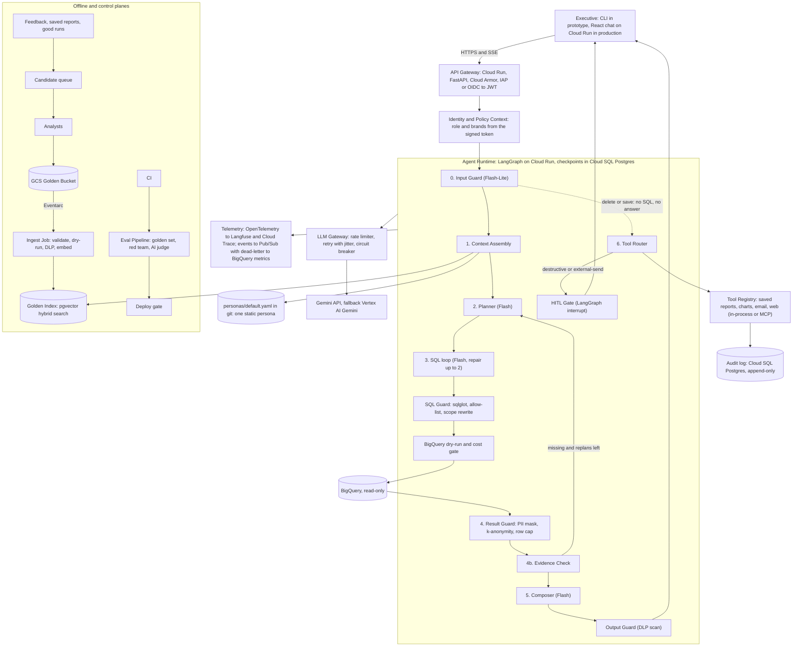

# Plan 11: Documentation and HLD
Status: not started
Estimate: about 1.5 h (our estimate; draft the diagram and explanation early, finish the example run last) · Depends on: 01 to 09 (10 if built) · Blocks: submission

**Goal:** Write the deliverable documents: the Mermaid architecture diagram (including the Input-Guard-to-Tool-Router delete-or-save shortcut, with each infra/framework/service choice named and explained), the technical explanation of every requirement including the design-only ones (reasoning for each choice, data flow and storage between components, error handling and fallback strategies), the framework choice with an experience statement, the README with setup instructions (including requirements.txt) and an example run, and the public GitHub repository that holds all of it.

Tags and `(impl)` marks are explained in plan 01.

The brief says the assessment focuses mainly on **system design, the technical explanation, and an elegant prototype**. This plan carries two of those three.

## Requirements covered
| ID | Deliverable | Source |
|---|---|---|
| D1 | Architecture diagram in Mermaid: building blocks, services, compute and flow, the delete-or-save shortcut, each infra, framework and service choice named with an explanation | PRD 8 |
| D2 | Technical explanation: reasoning per service, model and framework; data flow and storage between components; error handling **and fallback strategies**; how each of the 8 requirements is solved; detailed enough to see how it runs in production | PRD 8 |
| D3 | Setup instructions (including `pip install -r requirements.txt`) and an example run (plan 01 started the setup text) | PRD 8 |
| D5 | Public GitHub repository with docs, code and diagram | PRD 8 |
| D6 | Framework choice (LangGraph) with an honest experience statement | PRD 8 |
| F45, F50, F52, F53 | Design-only requirements: production observability, Golden update and retrieval, system learning, quality assurance. F51 (user memory) and F54 (persona management) are out of scope. | PRD 6.5, 6.6 |

D2 covers the brief's items 2.1, 2.2, 2.3 and 2.5. Item 2.4 (setup and example run) is D3, which lives in the README.

## Inputs and rules
- **decision.md is a summary.** For R6 (evaluation) the fuller sources are in the requirements folder: `README-evaluation.md` and the matching sections of `Phase1-decisions.md`. Read them when writing that section. `memoryAgent.md` is not used: the memory agent is out of scope (owner decision, 2026-10-22).
- Use the status tags ([DECIDED], [PROPOSED], [OPEN]) the way decision.md does, so the reader can see what is final.
- **Be honest about what is built.** Every design-only item is labelled as design, with its prototype stand-in from decision §8. Never describe an unbuilt feature as working.
- Write for the client (OpsFleet): the team lead and the project managers, who judge system design. Short sentences, tables, plain words, defined terms (decision.md's glossary is a good base).

## Deliverables

| File | Content | Covers |
|---|---|---|
| `docs/architecture.md` | The Mermaid diagram(s), the service table, the corrections list, the prototype-versus-production table | D1 |
| `docs/technical-explanation.md` | Framework, models, data flow, storage, errors and fallbacks, the eight requirements, NFRs, risks | D2, D6, F45, F50, F52, F53 |
| `README.md` | What it is, real versus design-only, setup, run, commands, example run, tests, layout, troubleshooting | D3 |
| Public GitHub repository | All of the above plus code, plans and PRD | D5 |

### `docs/architecture.md`
1. **Main diagram (production design).** Start from this draft and check it renders in a Mermaid viewer. Use quoted labels, as below.

2. **Request-path diagram.** Reuse decision.md's "Main request path" Mermaid block as the simple view.
3. **Service table.** One row per building block: what it does, the chosen technology, **why**, the rejected alternative, and the prototype stand-in. Take rows from decision section 2 (steps table) and section 3 (each "Rejected" and "Revisit if" line).
4. **Corrections to the source diagram** (decision section 2, "Differences from the diagram"): the delete-or-save shortcut; the Evidence Check's missing section 3.18; the Memory Store line, dropped because the memory agent is out of scope (owner decision, 2026-10-22); the **audit log in Cloud SQL Postgres, not BigQuery** (it must not share a pipeline with debug traces; only metrics go to BigQuery); the Persona Registry, Persona Admin UI, "CEO office" editing and per-user "My style", dropped because persona management is out of scope (owner decision, 2026-10-22); the step inputs that the diagram does not show; the login token versus a Postgres access-rules table (Q39).
5. **Prototype versus production table.** Copy decision section 8.
6. **Data stores and retention table.** Copy decision section 6, and keep its [NOT SPECIFIED] cells visible rather than filling them in.

### `docs/technical-explanation.md` (D2 and D6)
| Section | Content | Main source |
|---|---|---|
| 1. Summary and scope | What the system does; who uses it; prototype versus design-only | decision 1 |
| 2. Framework choice and experience (D6) | LangGraph, why, rejected options, when to revisit. **The experience statement is written by the author** (see blocking input). | 3.1, Q8 |
| 3. Models and routing | Gemini by step, fallback chain, why Pro is escalation only, model ID verification | 3.2 |
| 4. Data flow | Step by step, with the step-inputs contracts (what each step may see) | decision 2 steps, step-inputs tables |
| 5. Data and storage | Where each kind of data lives, PII, retention | decision 6, NFR21 |
| 6. Error handling and fallback strategies | The error-handling table, the retry and breaker design, the budget, the top-level boundary, fail-closed behavior, degraded mode | 3.10, 3.11, plan 04 |
| 7. The eight requirements | One subsection each (below) | decision 3, 7.1 |
| 8. Non-functional requirements | The NFR table with status tags | decision 4 |
| 9. Risks, assumptions, open questions | Top risks (S3, S4, S14), assumptions, the questions the client should answer first | decision 5, 9, 10 |
| 10. Extensibility | Tool manifests, registry, MCP, how charts, email and web search plug in behind the same HITL gate | 3.14 |
| 11. Rollout and operations | 5% traffic first and automatic rollback, cost levers, kill switch | NFR25, 3.11 |

**Section 7: how each requirement is solved**

| Req | Prototype or design | Content to write |
|---|---|---|
| R1 Hybrid Intelligence | Design (optional prototype slice, plan 10) | Trio format; Cloud Storage plus pgvector hybrid search; top 3 above a threshold; the **update loop** (analyst review, candidate queue, nightly re-check, no automatic promotion); **brand-tag filter (S5)**; step views; cold start |
| R2 Safety and PII | **Prototype** | The four layers table; SQL Guard rules and the inline-view scope rewrite; Result Guard parts A to E; fake customer IDs per session (owner decision); k = 10; ranked-list exception [open]; Output Guard; zero-PII rule; brand scope per user and the S14 fix |
| R3 High-Stakes Oversight | **Prototype** | Find, preview, confirm, delete; selectors; friction by risk; ID-set hash; soft delete and undo; audit log; idempotency keys; checkpointed pause; the delete-or-save shortcut |
| R4.1 User memory | **Out of scope** | One line only: no memory agent and no learned user profile (owner decision, 2026-10-22). Do not describe a memory design. |
| R4.2 System learning | Design | Thumbs-up, saved reports and good runs become candidates; analyst approval; weekly failure mining; poisoning and drift protection |
| R5 Resilience | **Prototype** | Typed errors; repair loop; empty-result broaden; loop stop rules; budget; gateway with limiter, retry, breaker, fallback; chaos flag |
| R6 Quality assurance | Design (stand-in pytest suite [PROPOSED]) | Three layers; four intent signals; golden set of 100 to 200; red team; about 50 human labels; evalkit and Promptfoo; deploy gate and 5% rollout; UX with 5 to 8 executive sessions and the System Usability Scale (target not set) |
| R7 Observability | **Prototype** (local) | Metrics list; trace IDs; spans; Langfuse and Cloud Trace; Pub/Sub to BigQuery; alerts on any PII at output; the deep-dive path from a trace ID to the full conversation view; masking rule for traces |
| R8 Persona Management | **Out of scope** (one static file is built) | A few lines only: no editor UI, registry, versions, approval, rollback or per-user style (owner decision, 2026-10-22). Two layers: locked rules and one static persona file in git; only the Composer sees persona text. Say plainly that a tone change is a code change, so brief item 8 is not met by design. Do not describe a persona-management design. |

Section 6 must include the full fallback chain (primary model, sibling model, Vertex AI Gemini, degraded mode) and say which parts the prototype builds.

### `README.md` (D3)
Sections: one-paragraph description; **what is real and what is design-only** (the decision section 8 table in short form); prerequisites (Python version tested, a Google Cloud project with BigQuery access, a Gemini API key); setup (`python -m venv`, `pip install -r requirements.txt`, `gcloud auth application-default login`, set `GOOGLE_CLOUD_PROJECT` and `GEMINI_API_KEY` in `.env`, `python -m src.cli.main doctor`); running (`chat --user alice`, `--chaos`); chat commands; the example users and their brands; the **example run**; tests (`pytest`, `pytest -m live`, the report command); repo layout; troubleshooting (credentials, quota and 429, brand check failure, a package that will not install); links to the architecture, the explanation, the PRD, the decision record and the plans.

**Example run rule:** paste real output from a real run, with real trace IDs. Never write one by hand. Show at least: a simple question; a why or report question; a refusal of a PII request; the delete flow with the single confirmation; `/trace`; one `--chaos` turn.

## Blocking input from the author
- **D6 experience statement (Q8).** decision.md says the author's experience level with LangGraph is still a placeholder. The statement must be the author's own and honest. Ask for it before writing section 2. If the experience is limited, say that plainly and describe what reduces the risk (a fixed graph, one node per concern, tests per node). Do not invent a level.
- **Public repository (D5).** Making the repository public and pushing is outward-facing. Confirm with the owner first.

## Tasks
- [ ] Draft `docs/architecture.md` from the diagram above. Check it renders. Fill the service table from decision sections 2 and 3.
- [ ] Draft `docs/technical-explanation.md` sections 1 and 3 to 11, reading `README-evaluation.md` and `Phase1-decisions.md` for R4.2 and R6.
- [ ] Ask the author for the experience statement. Write section 2.
- [ ] Reconcile every claim with the built prototype: for each requirement, check that "prototype" really means working and that every stand-in is named.
- [ ] Finish `README.md`. Capture the **real** example run last.
- [ ] Update stale statements: decision section 7.2 ("working prototype missing", "CLI missing") and each plan's status line once the work is done. Do not change decision.md's meaning; add a dated note.
- [ ] Repository hygiene before publishing: confirm `.env`, `venv/`, `data/`, `.deepeval/` and `__pycache__/` are ignored; search the git history and the tree for keys and tokens; keep `LICENSE`; remove stale files.
- [ ] Clean-machine test: clone to a new folder, new venv, `pip install -r requirements.txt`, `doctor`, one question, `pytest`. Fix the README where it fails.
- [ ] With the owner's approval, publish the repository and check that the Mermaid diagrams render on the hosting page.

## Tests and acceptance
- Each Mermaid block renders without errors.
- A reader can find, for every one of the eight requirements: the choice, the reason, the data flow, where data is stored, the error handling, and whether it is built or design-only.
- Every [OPEN] and [NOT SPECIFIED] item stays visible in the text (for example NFR6 byte cap, NFR8 daily budget, Q11 PII columns, S7 customer-row rule, Q5 saved report fields).
- No sentence claims a feature the prototype does not have.
- The README's setup steps work on a clean machine without help. The example output is copied from a real run.
- Acceptance: the repository URL opens publicly (after approval) with README, docs, code, and diagrams.

## Open items and defaults used
| Item | Default used | Who answers |
|---|---|---|
| Q8 experience statement | Author writes it | Author |
| Q18 production target and region | Cloud Run, Cloud SQL, Vertex AI, US (A7) | OpsFleet client |
| Q16 secrets, glossary and candidate queue storage | A secret store for keys; Postgres for glossary index | Us |
| Q39 token versus Postgres access rules | The token is the only source of brands | Us |
| Q40 Golden Ingest Job in or out of the client's scope | Keep a short update design | OpsFleet client |

## Risks and pitfalls
- Overclaiming. The easiest way to lose trust is a design-only item described as working. Label each one.
- A diagram that disagrees with the code or with decision.md. Re-read the diagram after the last code change.
- Doc time is cut when the build overruns (S4). Draft the diagram and the explanation while the build runs, so only the example run and the reconciliation remain at the end.
- A leaked key in the git history. Check before publishing, not after.

## Hand-off
- The owner reviews the documents, answers the P0 and P1 questions listed in the explanation, and approves publishing.
- After submission, the open questions in decision.md section 10 remain the client conversation.
